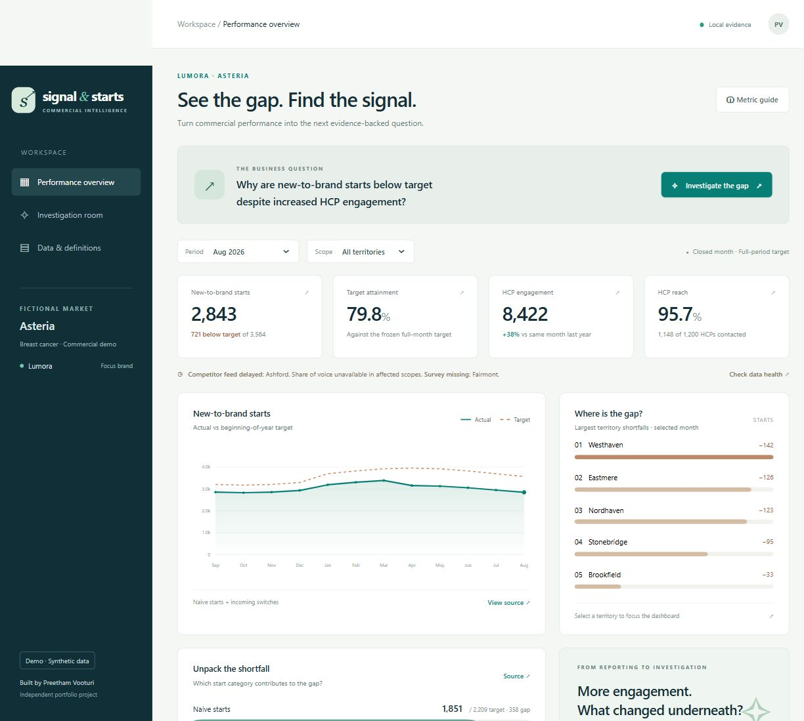
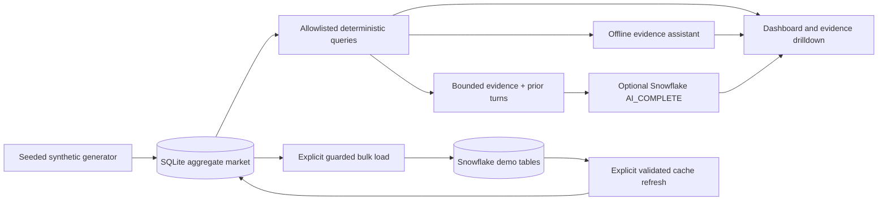

# Signal & Starts

**A dashboard that turns a commercial performance gap into a traceable investigation.**

Why are new-to-brand starts below target despite increased HCP engagement? This independent portfolio project by **Preetham Vooturi** explores that question in a completely fictional breast cancer market.

**Demo · Synthetic data.** All brands, HCPs, territories, activities, surveys and field observations are generated. No patient records, employer data, clinical model or real business results are used.



## Run in one command

Requires Python 3.10 or newer. The local app has **no third-party runtime dependencies** and makes no external calls by default.

```bash
python -m app.server
```

Open [http://127.0.0.1:8501](http://127.0.0.1:8501). First launch generates the market in a few seconds. Stop with Ctrl+C. Choose another port with `--port 8502`.

For a separate generation and validation:

```bash
python -m app.generate
python -m unittest discover -s tests -v
python -m scripts.evaluate
```

Generated databases, CSVs, credentials and local dependencies are excluded from Git. The seed and generator reproduce the dataset; a 31 MB database is unnecessary in the repository.

## The business story

In the default August 2026 market view, Lumora has **2,843 starts against 3,564 targeted**, while HCP engagement has risen **38.0% year on year**. A single market average conceals distinct territory patterns.

Choose **Explore Nordhaven** to investigate a specific finding:

- **217 / 340 starts**, or **63.8%** attainment.
- Incoming switches contribute **88 of the 123-start shortfall (71.5%)**.
- Engagement increases **38.1%**, yet only **50 of 100 HCPs** are reached.
- The most contacted quarter of HCPs receives **89.8% of contacts**.
- Field notes mention fictional process delays. They are **unverified hypotheses**, not causal proof.

Ask **“What should we investigate next?”**, then open an evidence citation. The next step is to validate coverage and the reported process barriers before deciding whether to increase activity. These numbers are reproducible demo outputs, not measured business impact.

## What works

| Capability | Delivered behavior |
| --- | --- |
| Dashboard | Actual vs frozen target, 12-month trend, territory shortfalls, naive/switch decomposition, reach and engagement |
| Investigation | Scope-aware follow-ups, evidence citations, source rows, query parameters, downloadable CSVs |
| Data limitations | Visible delayed competitor delivery, missing surveys, partial-period warnings; unsupported metrics withheld |
| Synthetic market | 36 months, 12 territories, 1,200 HCPs, **254,356 physical rows**, fixed seed 73021 |
| Evaluation | 10 scenario cases including negative controls; all passed in the recorded local run |
| Snowflake | Dedicated setup SQL, guarded bulk loader, reconciliation SQL, validated cache refresh, optional Cortex AI adapter |
| Portfolio assets | Screenshots, captioned 40-second walkthrough, recording script, LinkedIn draft |

### Honest AI modes

**Default: offline evidence assistant.** This is deterministic code over calculated evidence, with a supported question router and server-side conversational scope. It is **not a language model**. It handles starts, targets, switches, engagement, surveys, competitor activity, data quality and next checks. It asks for a narrower question outside those topics.

**Optional: live Snowflake AI.** `SIGNAL_AI_MODE=snowflake` enables `AI_COMPLETE` over a bounded evidence snapshot and prior turns. Source IDs are checked; semantic and numeric correctness still require review. Failures display a warning and explicitly labeled offline analysis. The app never claims that a configured connection is a verified live connection.

The dashboard queries **local SQLite** in both modes. An optional explicit Snowflake refresh validates and replaces that local cache; it is not a live Snowflake query on every click. See [Snowflake setup](docs/snowflake.md). No Snowflake login or live AI call was completed during the initial local build.

## Market and metrics

The fictional market is **Asteria**, with focus brand **Lumora** and competitors **Velaris** and **Arcelia**. The fixed simulation clock is **18 September 2026**; the 36-month data window runs October 2023–September 2026. September contains only 18 of 30 days. The default August view is a closed month.

New-to-brand = naive starts + incoming switches. These are simplified, mutually exclusive aggregate demo categories without clinical validity. Annual targets are fixed on January 1 and allocated by month and territory. Observed share of voice uses equal-weight contact counts across the three fictional brands. Service promoter score uses valid survey responses, with invitations and response bias explicitly documented.

Read the [metric contract and assumptions](docs/metrics-and-assumptions.md), [data dictionary](docs/data-dictionary.md), and [evaluation scope](docs/evaluation.md).

## Architecture



Python standard library HTTP server + SQLite + buildless HTML/CSS/JavaScript keep setup and running costs small. Models cannot execute SQL. Session history stays in process memory; restarting clears it. The app binds to loopback and is intended for local portfolio demonstrations. It has no production authentication or multi-user deployment contract.

See [architecture and decisions](docs/architecture.md) for tradeoffs, failure behavior and next engineering steps.

## Validation and scope

The recorded checks are **10 automated tests passing** plus **10/10 offline scenario cases passing**, with zero signal false positives/negatives across those finite cases. This does not measure general language understanding, clinical validity or live LLM quality. Expected labels are used by the evaluator, never passed into the investigation function. Metric reconciliation, invitation denominators, corruption, missing data, session scope, source export and HTTP boundaries have separate checks.

CI reruns Python tests, scenario evaluation and JavaScript syntax validation. Snowflake SQL, authentication, cost behavior and actual model responses need an authenticated account for execution. See [verification record](docs/verification.md).

## Demo and portfolio materials

- [40-second captioned walkthrough](artifacts/signal-and-starts-demo.mp4) — edited still captures of the tested local app; offline mode, no live AI or continuous-screen-recording claim.
- [Recording script and captions](docs/demo-script.md)
- [LinkedIn draft](docs/linkedin-draft.md)
- [Investigation screenshot](artifacts/investigation.jpg)
- [Evidence screenshot](artifacts/evidence.jpg)
- [Evaluation snapshot](docs/evaluation-results.json)

## Repository layout

```text
app/          generator, deterministic analytics, assistant, HTTP server, optional AI
web/          responsive dashboard and investigation UI
scripts/      evaluation, Snowflake loader and cache refresh, video assembly
snowflake/    dedicated demo setup and reconciliation SQL
tests/        data, scenario, conversation and HTTP checks
docs/         assumptions, architecture, validation, setup and portfolio copy
artifacts/    screenshots, captions and local demo video
```

**Author:** [Preetham Vooturi](https://github.com/preethamvooturi003) · Business analysis, data modeling, analytics and AI investigation design. This portfolio is independent of any employer. Project source is provided under the [MIT license](LICENSE).
