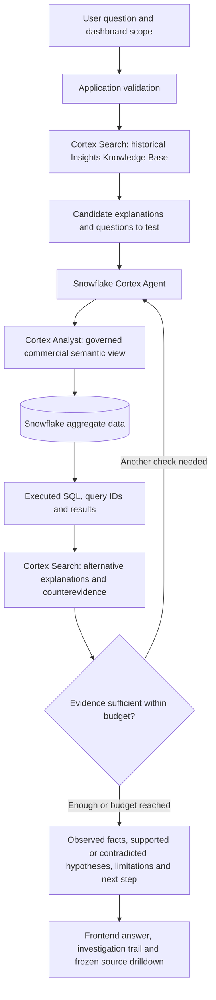

# Knowledge-first Snowflake investigation

This is the version 2 architecture. Local behavior and mocked native contracts are tested; native services have not been authenticated or executed in the trial account. The historical corpus is synthetic manager-style text, not real manager reports.

The app owns question validation, selected month/territory, publication filters, per-process run limits, mode labels and evidence snapshots. Snowflake owns native retrieval, semantic SQL generation/execution and iterative tool orchestration. A second application language model is unnecessary for this boundary: the app supplies a detailed investigation contract to one native Cortex Agent.

## Components

| Component | Implemented responsibility |
| --- | --- |
| `app/knowledge.py` | Reproducible corpus of 2,592 short manager-style documents, each one chunk; version, period, publication day, territory, brand, role, topic and evidence status |
| `scripts/prepare_insights.py` | Export to JSONL; explicit optional load into Snowflake `INSIGHT_CHUNKS` with count/identity checks |
| `snowflake/insights_search.sql` | Cortex Search service over text, with filterable brand, territory, period key and publication day |
| `snowflake/agent_views.sql` | Governed monthly commercial view, semantic metrics, completeness indicators and a dedicated read-only agent role |
| `app/workflow.py` | Offline equivalent of validate → retrieve → query → recheck → synthesize, using FTS5 and deterministic SQL |
| `app/snowflake_agent.py` | Mandatory native Search preflight, then a Cortex Agent with Analyst + Search tools, through the documented SQL `AGENT_RUN` wrapper |
| `app/server.py` | Session context and immutable per-response evidence snapshots, capped in memory |
| Frontend | Expandable execution trail, tested-hypothesis assessments and K01/Q01 source drilldown |

## What “verify the question” means

The app validates length, available period/territory, obvious write requests, clinical/patient-level requests and explicit period conflicts before any model call. This is a conservative scope gate, not a complete prompt-injection defense or a general language understanding model. Ambiguous questions can still need clarification from the native agent. The dashboard scope is authoritative until changed explicitly.

## Historical knowledge is a hypothesis source

For an August 2026 question, the retriever only admits reports about periods **before August**, published by the August reporting cutoff. September is capped at the fixed simulation clock of 18 September 2026. Scope filters include Lumora and the requested territory; a whole-market question can use all territories. The corpus includes potentially competing explanations: uneven coverage, reported process friction, incoming-switch changes, stretched targets, volatility and explicit counterevidence.

The corpus comes from transparent authored templates. It is reproducible test material, not a claim that 2,592 real managers' reports were gathered or that local FTS5 is semantic/vector search. Native mode uses Cortex Search's retrieval service; offline mode uses lexical FTS5. An organization could replace the synthetic corpus with approved reports through a separate permissioned ingestion process.

Each retrieved report carries `historical_hypothesis_unverified`. Even if a current metric matches the described pattern, causality remains unestablished. The system deliberately retrieves alternatives after querying metrics. A process narrative cannot be verified without independent aggregate workflow evidence, which this dataset does not contain.

## Example: challenge the volatility narrative

1. Retrieve an older insight describing a volatile fictional market.
2. Form a specific check: sum all-brand aggregate starts by month across all 12 territories, then compute population standard deviation / mean over six contiguous closed months.
3. In the August 2026 reference case, CV is **4.05%**. Under the explicitly demo-specific **15% heuristic**, this weakens the volatility narrative.
4. Revisit coverage and switch-mix explanations. In Nordhaven, contact concentration and declining incoming switches support further investigation. They still do not prove a cause.

The CV is a descriptive variability measure, not a pharmaceutical standard, causal test, volatility model or seasonally adjusted statistic. Missing aggregate rows or noncontiguous periods withhold it.

## Native orchestration contract

The application finishes a filtered `SEARCH_PREVIEW` call before `AGENT_RUN` starts. The inline Agent specification exposes only Cortex Analyst over `COMMERCIAL_ANALYTICS` and Cortex Search over `INSIGHTS_SEARCH`. It supplies prior conversation turns and retrieved insights as untrusted source data. The native agent is instructed to test hypotheses, run selective queries, seek counterevidence and stop with unresolved limitations where appropriate.

A live answer is accepted only when the response has no warnings/errors, an Analyst invocation, actual executed query provenance, a successful Search recheck after query evidence, and `[K01]` / `[Q01]` citations. Missing tools, insufficient provenance, timeouts or malformed responses produce a visible warning and explicitly labeled offline analysis. Native model thinking is never forwarded to the UI or source cards. These checks establish execution provenance, not semantic accuracy or causal validity.

Source cards freeze the historical chunks, SQL and query IDs for that particular answer. They are addressed by a response-specific opaque evidence ID and checked against month/territory. Up to 200 snapshots are kept in memory; expired snapshots return an explicit error. SQL result representations are bounded; the full Snowflake result must be inspected through the query ID. Conversation history and snapshots are not durable audit storage.

## Setup and trial cost

1. Complete the existing secure named Snowflake connection and market load described in [snowflake.md](snowflake.md).
2. Review and run `snowflake/agent_views.sql` with a provisioning role. Grant `SIGNAL_DEMO_AGENT_ROLE` to the intended demo user; the application explicitly switches to that role and fails if unavailable.
3. Run `python -m scripts.prepare_insights --load` with the provisioning connection. It refuses an already populated knowledge table.
4. Review and run `snowflake/insights_search.sql`. This starts a paid Search service; it is never created automatically by app startup.
5. Set `SIGNAL_AI_MODE=snowflake_agent`, `SNOWFLAKE_CONNECTION_NAME=signal_starts`, and optionally `SIGNAL_AGENT_MAX_RUNS=5`; restart the app.
6. Verify actual retrieval, query results and model responses before recording a live demonstration. Suspend Search indexing **and serving** after use using the supplied SQL commands.

Default native run cap: five attempted investigations per process, including failures. Native orchestration budget: 40 seconds and 8,000 orchestration tokens. The prompt requests at most three analytical checks and two Search lookups; those tool counts are model instructions, not hard billing limits. Analyst/Search tool usage is outside the orchestration token budget. Warehouse resource monitors do not cap all AI/Search spending. Search indexing and serving can incur charges while no questions are being asked. No claim about trial expiry or guaranteed feature/model availability is made.

Dashboard numbers continue to come from the local cache; native investigation query cards are explicitly Snowflake results. A changed warehouse snapshot can therefore differ from cached dashboard figures. Refresh and reconcile the cache before a recording; the app does not silently relabel cached figures as live data.

## Official implementation references

- [Cortex Agents orchestration and tool contracts](https://docs.snowflake.com/en/user-guide/snowflake-cortex/cortex-agents-run)
- [SQL AGENT_RUN wrapper](https://docs.snowflake.com/en/sql-reference/functions/agent_run-snowflake-cortex)
- [Cortex Search SQL preview](https://docs.snowflake.com/en/sql-reference/functions/search_preview-snowflake-cortex)
- [Semantic view definition](https://docs.snowflake.com/en/sql-reference/sql/create-semantic-view)
- [Search service suspension](https://docs.snowflake.com/en/sql-reference/sql/alter-cortex-search)

These interfaces were checked against official documentation on 29 October 2026. SQL service provisioning and native responses still require authenticated execution in the actual account.
